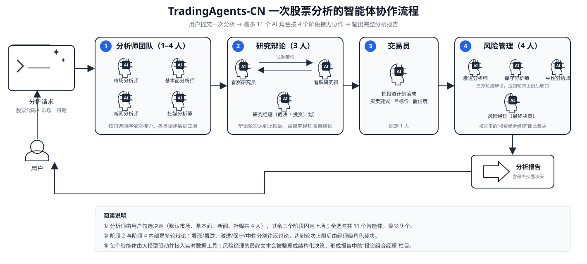
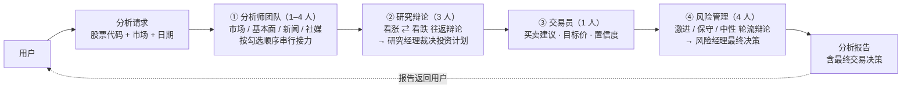

# 股票分析协作流程介绍图_20261022

> 面向客户的一次股票分析流程介绍图，依据 `docs/faq/TradingAgents百问百答.md` 第 6 问「执行一次股票分析会有哪些角色」整理绘制。

## 流程图

## 角色总览

| 阶段 | 角色 | 人数 | 说明 |
| --- | --- | --- | --- |
| 1 分析师团队 | 市场 / 基本面 / 新闻 / 社媒分析师 | 1–4 | 由用户勾选决定，按选择顺序串行接力，各自绑定数据工具 |
| 2 研究辩论 | 看涨研究员、看跌研究员、研究经理 | 3（固定） | 看涨看跌往返辩论，达轮次上限后研究经理给出投资计划 |
| 3 交易员 | 交易员 | 1（固定） | 把投资计划落成买卖建议、目标价、置信度 |
| 4 风险管理 | 激进 / 保守 / 中性风险分析师、风险经理 | 4（固定） | 三方轮流辩论后由风险经理给出最终交易决策 |

- 默认全选分析师时共 **11 个智能体**，最少选 1 个分析师时 **9 个**。
- 报告中的「投资组合经理」展示的是风险经理（`Risk Judge`）的裁决，并非独立智能体。
- `SignalProcessor` 不是角色，仅负责把最终文本整理为结构化决策。

## Mermaid 源码（可二次编辑）

## 参考来源

- `docs/faq/TradingAgents百问百答.md` 第 6 问「执行一次股票分析会有哪些角色」
- `tradingagents/graph/setup.py`：LangGraph 节点装配
- `app/models/analysis.py`：默认 `selected_analysts`
